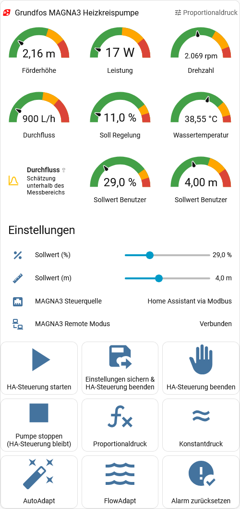

### Grundfos MAGNA3
**Home Assistant Modbus TCP**

<br clear="left"/>

**YAML package to integrate a Grundfos MAGNA3 circulation pump into Home Assistant via Modbus TCP (CIM 500 module).**

<a href="README.de.md">Deutsche Version</a>

---

## Features

- **40+ sensors**: Head pressure, flow rate, speed, power consumption, temperatures, energy usage, operating hours, PID parameters and more
- **Status bits**: 11 binary sensors decoded from the status register (pump running, alarm, warning, remote mode, ...)
- **Computed values**: Efficiency, energy cost, setpoint in meters, firmware version (BCD decoding), alarm/warning text
- **Control**: Remote start/stop, change control mode (AUTOADAPT, FLOWADAPT, proportional pressure), set setpoint (% and meters)
- **Automations**: Alarm and warning notifications, high-current detection, ForcedToLocal detector, bidirectional setpoint synchronization
- **Dashboard card**: Ready-to-use Lovelace card with gauges, control buttons and status indicators

## Entity Quality

All sensors and registers have been carefully defined with correct and complete HA metadata: `unique_id`, `device_class`, `state_class`, `unit_of_measurement`, `scale`, `precision` and `scan_interval` are carefully set for each entity to best match its purpose. This ensures that long-term statistics, energy dashboard integration and history graphs work out of the box without manual adjustments.

## Requirements

- Home Assistant (any current version)
- Grundfos MAGNA3 pump
- Grundfos **CIM 500** communication module (sold separately, installed inside the pump to provide the Modbus TCP interface)
- Network connection between HA and CIM 500

## Installation

1. Copy `grundfos_magna3.yaml` to `/config/packages/`
2. Ensure packages are enabled in `configuration.yaml`:
   ```yaml
   homeassistant:
     packages: !include_dir_named packages
   ```
3. Update the CIM 500 IP address (in the `modbus:` block, key `host:`):
   ```yaml
   host: 192.168.2.7  # ← CHANGE: IP address of your CIM 500
   ```
4. Restart Home Assistant

> **German version:** All entity names, automation texts and comments in German: `grundfos_magna3.de.yaml` and `dashboard_card.de.yaml`.
>
> **Install only one language version.** Both use the same `unique_id`s and the same Modbus hub; together they collide. When switching languages, remove the old file. For a second pump, the hub name, `unique_id`s and entity IDs must be changed.

## Dashboard Card (optional)
</p>
(Sorry for the German screenshot. The Dashboard is available in English, but I can only have one YAML installed)
</p>
<p align="center">
  
</p>
The file `dashboard_card.yaml` contains a ready-to-use Lovelace card with gauges, control buttons and status indicators.

**Usage:** Paste the contents of `dashboard_card.yaml` as a manual card (YAML) in the dashboard editor.

**Operation:** The setpoint sliders and the control mode buttons (Proportional Pressure, Constant Pressure, AutoAdapt, FlowAdapt) only take effect while HA controls the pump (Remote). In local mode the pump ignores these requests, so they are greyed out then. First "Start HA Control", then change setpoint or control mode; to store it permanently use "Save Settings & End HA Control". After start or end the display switches after about 2 s; if control changes some other way (pump display, Grundfos GO), after 30 s at most.

"Save Settings & End HA Control" is only available under HA control and always switches the pump on, even if it was stopped via HA before: a stored "Off" would leave the heating circuit pump standing after control ends. "Reset Alarm" takes over control and switches the pump on as well.

**Pump-specific values:** The card's gauge maxima (153 W, 4530 rpm, 5500 L/h, 10 m), the maximum of the meter slider (10 m) and the 5 A current threshold in `magna3_high_current` fit my pump. For a different pump size please adjust them (see the pump's data sheet).

### Required HACS Cards

The dashboard card requires the following HACS frontend extensions:

| HACS Card | Purpose | HACS Search |
|---|---|---|
| [**Vertical Stack In Card**](https://github.com/ofekashery/vertical-stack-in-card) | Outer container without borders | `vertical-stack-in-card` |
| [**UIX (UI eXtension)**](https://github.com/Lint-Free-Technology/uix) | CSS styling (remove borders, colors, grey out sliders in local mode). Installed as an integration, docs: [uix.lf.technology](https://uix.lf.technology/) | `uix` |
| [**button-card**](https://github.com/custom-cards/button-card) | Control buttons with tooltips, multi-line labels, custom icon sizing | `button-card` |
| [**Mushroom**](https://github.com/piitaya/lovelace-mushroom) | Template card for flow status | `mushroom` |

Without these cards the dashboard card will not render correctly. The Modbus YAML itself works independently.

**UIX instead of card-mod since v4.4:** the card uses `uix:` instead of `card_mod:`. card-mod has not been developed further since February 2026; UIX comes from the same circle and also understands old `card_mod:` blocks. With card-mod instead of UIX the card still works, but the styling and the greying out of the sliders in local mode are missing. The buttons are greyed out by button-card itself, which also works without UIX.

## Monitoring & Notifications

The pump itself reports problems via two status bits in register 00201 (bit 10 "Alarm" = red LED, bit 11 "Warning" = orange LED) plus concrete error codes in registers 00205 (alarm) and 00206 (warning). Four preconfigured automations evaluate these and place corresponding entries in the HA notification drawer:

| Automation | Trigger | What it reports |
|---|---|---|
| `magna3_alarm_notification` | Reg 00201 bit 10 → on, code change while the alarm is active | 🚨 Alarm with code (Reg 00205, read fresh before notifying) and plain text (e.g. "Dry running", "Overcurrent", "Sensor fault"). A new code updates the same notification. Pump typically shuts off |
| `magna3_warning_notification` | Reg 00201 bit 11 → on, code change while the warning is active | ⚠️ Warning with code (Reg 00206, read fresh; a new code updates the same notification). Pump keeps running, but attention needed (e.g. sensor drift, bearing service due) |
| `magna3_high_current` | Motor current > 5 A for 5 min | ⚠️ Early indicator of mechanical issues — before the pump itself triggers an overtemperature shutdown |
| `magna3_forced_to_local_detected` | Reg 00201 bit 12 → on | ⚠️ Pump was forced into local mode by something other than HA (interaction at the pump display, Grundfos GO app, digital input) — HA control is not possible while this lasts |

**Connection loss:** If the pump cannot be reached (e.g. without power), the derived sensors (status bits, plain texts, energy cost, efficiency …) are "unavailable" instead of "off", "No alarm" or 0. Measurement registers returning the Grundfos value 0xFFFF ("not available") are treated the same way. Exception: "Flow Rate L/h" shows 0 then, so history graphs next to other devices stay continuous.

**Important:** Status registers are polled **every 30 seconds** via Modbus, **regardless** of whether HA is controlling the pump or the pump is running locally. Alarms during purely local pump operation still reliably reach the HA notification drawer.

**Acknowledge:** Active alarms are cleared via the dashboard button *"Reset Alarm"* (script `magna3_reset_alarm` — writes a rising-edge trigger on Reg 00101 bit 2). Note: the reset only works once the underlying root cause (e.g. dry-running condition) has been resolved. Warnings, in contrast, disappear automatically once the cause is gone.

**Extension:** If you want push notifications to your phone (instead of just the HA drawer), you can extend the relevant automation with a second `action:` calling `notify.mobile_app_<device>`. Example:

```yaml
- id: magna3_alarm_notification
  alias: "MAGNA3: Alarm Notification"
  trigger:
    - platform: state
      entity_id: binary_sensor.magna3_alarm
      to: 'on'
  action:
    - action: persistent_notification.create
      data:
        title: "🚨 MAGNA3 Alarm"
        message: "Code: {{ states('sensor.magna3_alarm_code') }} ({{ states('sensor.magna3_alarm_text') }})"
    - action: notify.mobile_app_your_phone   # ← adjust or remove
      data:
        title: "🚨 MAGNA3 Alarm"
        message: "Code: {{ states('sensor.magna3_alarm_code') }} ({{ states('sensor.magna3_alarm_text') }})"
```

## Register Overview

### Measurement Values (Read-Only)

| Register | Sensor | Unit | Interval |
|---|---|---|---|
| 00201 | Status bits (11 binary sensors) | Bitfield | 30s |
| 00202 | Process feedback | % | 30s |
| 00301 | Head pressure | m | 15s |
| 00302 | Volume flow | m³/h | 15s |
| 00303 | Relative performance | % | 15s |
| 00304 | Speed | rpm | 15s |
| 00305 | Frequency | Hz | 15s |
| 00308 | Setpoint (current) | % | 15s |
| 00309 | Motor current | A | 30s |
| 00310 | DC link voltage | V | 30s |
| 00312-13 | Power consumption | W | 15s |
| 00321 | Electronic Temp | K | 15s |
| 00322 | Pump Liquid Temp | K | 15s |
| 00326 | Specific energy consumption | Wh/m³ | 300s |
| 00327-28 | Operating hours (running) | h | 300s |
| 00329-30 | Operating hours (total) | h | 300s |
| 00332-33 | Energy consumption | kWh | 300s |
| 00334-35 | Number of starts | - | 300s |
| 00338 | Setpoint (user) | % | 15s |
| 00339 | Differential pressure | bar | 30s |
| 00357-58 | Pumped volume | m³ | 300s |

### Control Registers (Read-Write)

| Register | Function | Values |
|---|---|---|
| 00101 | Control register | Bit 0: Remote, Bit 1: On/Off, Bit 2: Reset |
| 00102 | Control mode | 6=Proportional, 128=AUTOADAPT, 129=FLOWADAPT |
| 00104 | Setpoint | 0-10000 (= 0-100%) |

### Optional Registers (commented out)

The YAML contains additional registers as commented-out blocks:
- **00105** RelayControl (not relevant for MAGNA3)
- **00110-00112** PID parameters (Kp, Ti, control direction) — **experts only!**
- **00316** Remote pressure sensor
- **00320** Remote temperature sensor
- **00352-00356** Heat energy (with external temperature sensor)

## Individual Customization

### Electricity Price

The value `0.30` for the energy cost calculation should be adjusted to your own electricity price:
```yaml
state: >
  {{ (states('sensor.magna3_energy_consumption') | float(0) * 0.30) | round(2) }}
  # ↑ Adjust electricity price!
```

### Scan Intervals

Intervals are conservatively set (15-300s). They can be adjusted as needed. Overly aggressive intervals (< 5s) may strain the Modbus communication.

## Documentation

Based on the official Grundfos Modbus document:
[**98367081 05.2025 — Modbus for Grundfos pumps** (PDF)](https://api.grundfos.com/literature/Grundfosliterature-6012947.pdf)

## Contributing

Questions, bug reports and suggestions for improvement are always welcome! Please use [GitHub Discussions](https://github.com/TRON4R/ha-grundfos-magna3-modbus/discussions) or open an [Issue](https://github.com/TRON4R/ha-grundfos-magna3-modbus/issues).

## License

[MIT](LICENSE)
